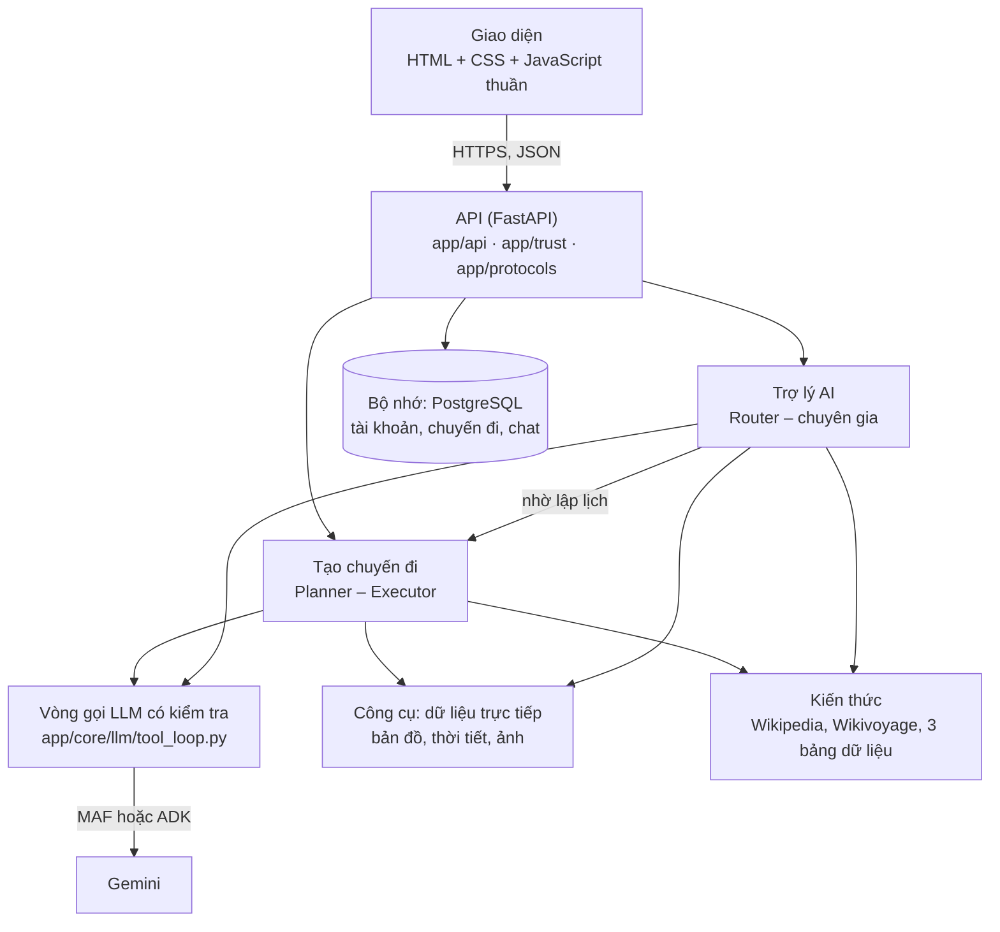
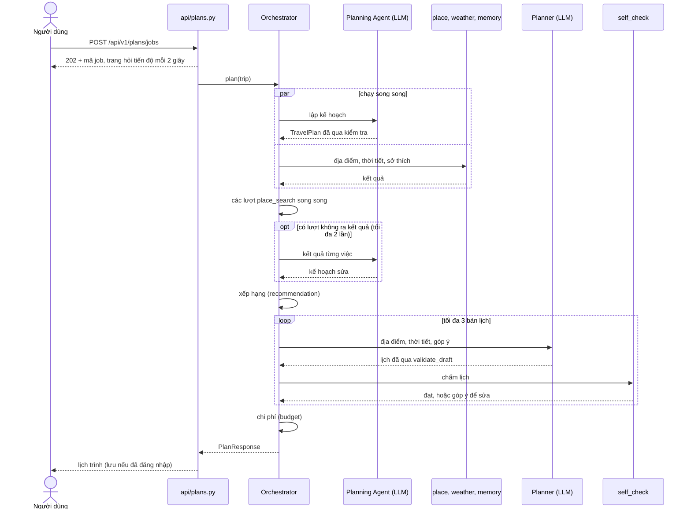
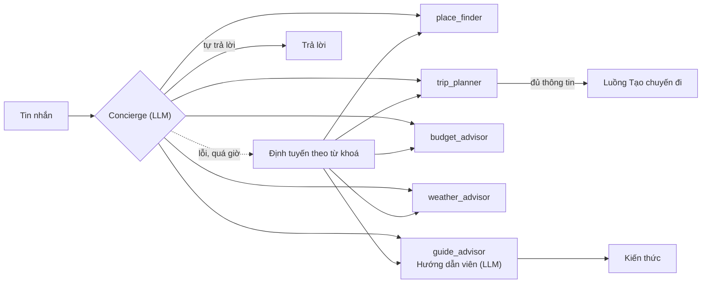
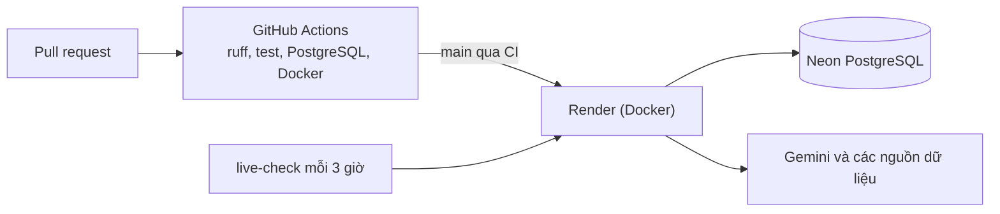

# Kiến trúc TravelMate

Tài liệu này trả lời ba câu hỏi: hệ thống gồm những phần nào, các phần nói chuyện với nhau ra sao,
và vì sao chọn cách đó. Phần kiến thức (knowledge) có tài liệu riêng: [`knowledge.md`](knowledge.md).

## 1. Kiến trúc trong một câu

TravelMate là **một ứng dụng FastAPI chạy một tiến trình, chia lớp**, bên trong có **hai kiến trúc agent**:

| Chức năng trên trang | Kiến trúc agent | Mã |
|---|---|---|
| **Tạo chuyến đi** | **Planner – Executor**: một agent LLM lập kế hoạch, orchestrator giao việc cho các agent khác rồi gom kết quả | `app/agents/planning.py` |
| **Trợ lý AI** | **Router (hand-off)**: một agent LLM đọc câu hỏi rồi chuyển cho chuyên gia phù hợp | `app/agents/concierge.py` |

Hai kiến trúc dùng chung nguồn dữ liệu, vòng gọi LLM và cơ sở dữ liệu.

## 2. Các lớp

| Lớp | Thư mục | Trách nhiệm |
|---|---|---|
| Giao diện | `frontend/travelmate-v2/` | Hiển thị, gọi API; không chứa khoá hay logic agent |
| API | `app/api/`, `app/trust/`, `app/protocols/` | Nhận yêu cầu, đăng nhập, hạn mức, đổi lỗi thành mã HTTP |
| Agent | `app/agents/` | Lập kế hoạch, xếp lịch, trả lời, tự kiểm tra |
| Vòng gọi LLM | `app/core/llm/` | Gọi Gemini qua MAF hoặc ADK, giới hạn số lượt, thử lại |
| Công cụ, kiến thức | `app/tools/`, `app/data/` | Lấy dữ liệu; không tự quyết định |
| Bộ nhớ | `app/memory/` | PostgreSQL (Render + Neon) hoặc SQLite ở máy |
| Ghép nối | `main.py`, `services.py`, `settings.py` | Đọc cấu hình, chọn và nối các phần |

`app/specialists/`, `app/place_agent/`, `app/tools/browser_weather/` và `app/evaluation/` là bài thực hành
hoặc công cụ đo, chạy riêng. Trang web không đi qua chúng, trừ `specialists/weather.py` (gọi Open-Meteo)
và `specialists/memory.py` (chỉ khi cấu hình `TRAVELMATE_MEMORY_USER`).

## 3. Các agent

Trang web có **10 agent: 4 dùng LLM, 6 không dùng LLM**.

| Agent | LLM | Nhận → trả | Mã |
|---|---|---|---|
| Planning Agent | Có | Yêu cầu chuyến đi → kế hoạch các việc con (`TravelPlan`) | `agents/planning.py` |
| Planner (xếp lịch) | Có | Địa điểm, thời tiết, ràng buộc → lịch từng ngày (`Draft`) | `agents/itinerary.py` |
| Concierge | Có | Hội thoại → quyết định chuyển việc (`Decision`) | `agents/concierge.py` |
| Hướng dẫn viên | Có | Câu hỏi → câu trả lời có trích dẫn (`KnowledgeAnswer`) | `agents/guide.py` |
| place | Không | Chuyến đi → địa điểm, nơi ở | `agents/place.py` |
| place_search | Không | Loại + từ khoá → địa điểm | `agents/planning.py` |
| weather | Không | Chuyến đi → thời tiết từng ngày | `agents/weather.py` |
| memory | Không | Chuyến đi → sở thích | `memory/preferences.py` |
| recommendation | Không | Địa điểm + sở thích → địa điểm đã xếp hạng | `agents/recommendation.py` |
| budget | Không | Lịch → chi phí so với ngân sách | `agents/budget.py` |

Planner và 6 agent không LLM kế thừa `BaseAgent` (`core/base.py`): kiểm tra dữ liệu vào và ra, giới hạn thời
gian, ghi log. Ba agent LLM còn lại là lớp riêng; nơi gọi chúng đặt giới hạn thời gian hoặc giới hạn lượt gọi.

Trong chat, địa điểm, lịch trình, chi phí và thời tiết là **hàm xử lý** của `ChatService`, dùng lại nguồn dữ
liệu và agent ở trên; chỉ Hướng dẫn viên là agent LLM riêng. Tự kiểm tra lịch (`self_check.py`) và xếp lịch
theo luật (`rule_scheduler.py`) là hàm, không phải agent.

## 4. Luồng "Tạo chuyến đi"

- Việc chạy nền (`plan_jobs.py`) giữ trong bộ nhớ của tiến trình. Máy chủ khởi động lại thì job đang chạy mất.
- Giữ lại **bản lịch ít lỗi nhất**, không nhất thiết là bản cuối.
- `TRAVELMATE_ORCHESTRATOR` chọn một trong ba cách điều phối:

| Giá trị | Cách làm |
|---|---|
| `planning` (chạy trên Render) | Sơ đồ trên |
| `classic` (mặc định trong code) | Chạy tuần tự, không có Planning Agent và không có vòng tự sửa |
| `workflow` | Cùng luồng và luật như `classic`, dựng bằng đồ thị MAF Workflow |

## 5. Luồng "Trợ lý AI"

Câu ghép có thể chuyển cho nhiều chuyên gia; lịch trình chạy trước chi phí và thời tiết.

## 6. LLM được gọi như thế nào

Cả bốn agent LLM đi qua `run_tool_loop` trong `core/llm/tool_loop.py`. LLM **đọc dữ liệu qua công cụ** và
**nộp kết quả qua công cụ có kiểm tra**; trả lời thẳng bằng chữ không được nhận.

| Agent | Công cụ đọc | Công cụ nộp | Kiểm tra | Giới hạn lượt gọi model |
|---|---|---|---|---|
| Planning Agent | `inspect_request` | `submit_plan` | Đủ 5 việc chính, phụ thuộc đúng, không có vòng (`TravelPlan`) | 6 |
| Planner | `inspect_trip` | `submit_itinerary` | Đủ ngày, địa điểm có thật, không trùng giờ (`validate_draft`) | 8 |
| Concierge | `read_conversation` | `decide` | Chuyên gia hợp lệ, đủ tham số (`Decision`) | 4 |
| Hướng dẫn viên | `search_knowledge` | `submit_answer` | Trích dẫn có thật, mọi con số có trong nguồn | 7 |

Context của mỗi lần chạy gồm: hướng dẫn cố định, một câu mở đầu ngắn, kết quả các công cụ đã gọi và lỗi của
lần nộp trước. Hướng dẫn viên là ngoại lệ: câu hỏi của người dùng nằm ngay trong câu mở đầu. Dữ liệu còn
thiếu là `null` trong JSON, và công cụ dặn model hiểu đó là "chưa biết", không phải 0.

Trên MAF (`AGENT_ENGINE=maf`, bản chạy trên Render), hai middleware giữ các giới hạn này:
`ModelCallBudget` (ChatMiddleware) đếm lượt gọi model; `FailClosedTools` (FunctionMiddleware) dừng khi công cụ
báo lỗi và dừng ngay khi bài được nhận.

## 7. Tám thành phần của một agent

| Thành phần | Trong TravelMate |
|---|---|
| Model | Gemini, qua MAF hoặc ADK |
| Tools | Photon, Overpass, Open-Meteo, MET Norway, Wikimedia; công cụ đọc và nộp ở mục 6 |
| Knowledge | Wikipedia, Wikivoyage, bảng giá vé, giá tham khảo, ranh giới tỉnh: [`knowledge.md`](knowledge.md) |
| Context | Mục 6; `request_id` nối log của một lần chạy |
| Memory | Ngắn hạn: phiên chat (`TripSlots`, 12 tin gần nhất). Dài hạn: chuyến đi, hội thoại và sở thích trong tài khoản; sở thích được điền sẵn vào form |
| Planning | Planning Agent: chia việc, xem kết quả, lập lại kế hoạch |
| Orchestration | `PlanningOrchestrator` và `ChatService` |
| Trust | Cổng nộp bài, tự kiểm tra, đăng nhập và CSRF, hạn mức AI, log, test, kiểm tra trang thật. Guardrails riêng **chưa làm** |

Agent `memory` đọc được sở thích lưu riêng ở máy chủ, nhưng bản trên Render không cấu hình
`TRAVELMATE_MEMORY_USER`, nên ở đó nó chỉ dùng sở thích trong yêu cầu.

## 8. Vì sao chọn kiến trúc này

| Quyết định | Lý do | Cái giá phải trả |
|---|---|---|
| Nhiều agent thay vì một prompt lớn | Mỗi bước kiểm tra và thay thế riêng được; chỉ 4 agent tốn lượt LLM | Nhiều lượt gọi nối tiếp nên chậm hơn |
| Planner – Executor cho tạo lịch | Thực hiện được mong muốn riêng trong ghi chú, lập lại khi tìm không ra | Thêm lượt gọi LLM trước khi xếp lịch |
| Router cho chat | Mỗi câu chỉ chạy chuyên gia cần thiết | Định tuyến sai thì trả lời sai hướng |
| LLM phải nộp bài qua công cụ | Kết quả sai luật không đi tiếp | Có thể mất thêm lượt sửa |
| Một tiến trình, không chia microservice | Triển khai miễn phí, dễ chạy và sửa | Job nền mất khi khởi động lại; chưa chạy được nhiều máy |
| Nguồn dữ liệu miễn phí | Không tốn tiền, ai cũng chạy lại được | Nguồn có thể chậm, thiếu hoặc giới hạn lượt gọi |

## 9. Khi một phần bị lỗi

| Phần lỗi | Hệ thống làm gì |
|---|---|
| Planning Agent | Dùng kế hoạch mặc định gồm 5 việc chính |
| Planner | Xếp lịch theo luật, có cảnh báo |
| Concierge | Định tuyến theo từ khoá |
| Hướng dẫn viên | Trích nguyên văn nguồn đã tìm được |
| Photon | Lấy điểm tham quan từ Wikipedia (thiếu quán ăn và nơi ở) |
| Open-Meteo | MET Norway (khoảng 10 ngày); ngày xa hơn thử thời tiết các năm trước |
| Cả hai nguồn thời tiết | Vẫn có lịch, kèm cảnh báo chưa xác minh thời tiết |
| Không tìm được địa điểm | Dừng và báo lý do: đây là phần bắt buộc |

## 10. Triển khai

Chi tiết: [`deploy.md`](deploy.md).
