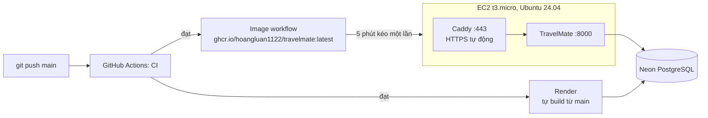

# Chạy TravelMate trên AWS EC2 (Render làm dự phòng)

Trang chính chạy trên một máy ảo **EC2 t3.micro** của AWS, trả bằng tín dụng của gói miễn phí.
Render (xem [deploy.md](deploy.md)) vẫn chạy song song từ cùng nhánh `main`, cùng cơ sở dữ liệu Neon:
hai trang dùng chung tài khoản và chuyến đi, trang nào hỏng thì dùng trang kia.



| Phần | Ở đâu | Ghi chú |
|---|---|---|
| Máy chủ | EC2 `t3.micro` (2 vCPU, 1 GB RAM + 2 GB swap), vùng Singapore | Không ngủ như Render, có IP riêng |
| HTTPS | Caddy trong Docker, chứng chỉ Let's Encrypt | Tự gia hạn |
| Địa chỉ | `https://<IP-có-gạch-ngang>.sslip.io` (miễn phí, không cần mua tên miền) | Đổi sang tên miền riêng được |
| Cơ sở dữ liệu | Neon (giữ nguyên) | Không phải chuyển dữ liệu |
| Cập nhật | GitHub Actions build image sau khi CI đạt; máy EC2 tự kéo 5 phút một lần | Không cần mở SSH cho GitHub |

## Chi phí

Ước tính ở Singapore (giá niêm yết của AWS, có thể thay đổi; xem lại ở **Billing → Bills**):

| Khoản | Khoảng |
|---|---|
| EC2 t3.micro chạy cả tháng | ~9,6 USD |
| Địa chỉ IPv4 công khai (Elastic IP) | ~3,6 USD |
| Ổ đĩa EBS gp3 16 GB | ~1,5 USD |
| **Tổng** | **~14–15 USD/tháng** |

Tín dụng 100 USD đủ cho khoảng 6–7 tháng, và gói miễn phí hết hạn ngày **24/05/2027**. Sau đó, nếu
không nâng cấp tài khoản, máy EC2 dừng; trang trên Render vẫn chạy.

**Đặt cảnh báo trước khi làm gì khác**: **Billing → Budgets → Create budget → Monthly cost budget**,
ngưỡng 15 USD, nhập email của bạn. AWS gửi thư khi chi tiêu gần chạm ngưỡng.

## 1. Tạo máy EC2

Đăng nhập [AWS Console](https://console.aws.amazon.com), chọn vùng **Asia Pacific (Singapore) ap-southeast-1**
ở góc trên bên phải, rồi **EC2 → Launch instance**:

| Mục | Chọn |
|---|---|
| Name | `travelmate` |
| Application and OS Images | **Ubuntu Server 24.04 LTS**, kiến trúc **64-bit (x86)** |
| Instance type | **t3.micro** |
| Key pair | **Create new key pair** → tên `travelmate`, RSA, `.pem` → tải về, cất kỹ (mất là không SSH được) |
| Network settings → Firewall | **Create security group**, tích **Allow SSH traffic from: My IP**, **Allow HTTPS traffic from the internet**, **Allow HTTP traffic from the internet** |
| Configure storage | **16 GiB gp3** |
| Advanced details → Credit specification | **Standard** (không bị tính thêm khi CPU chạy cao lâu) |

Bấm **Launch instance**.

Cổng 80 phải mở: Let's Encrypt dùng nó để xác nhận địa chỉ trước khi cấp chứng chỉ HTTPS.

## 2. Gắn địa chỉ IP cố định (Elastic IP)

IP thường đổi mỗi lần máy tắt/bật, kéo theo địa chỉ `sslip.io` đổi. Elastic IP giữ nguyên và giá như IP thường.

**EC2 → Elastic IPs → Allocate Elastic IP address → Allocate**, rồi chọn IP vừa tạo →
**Actions → Associate Elastic IP address** → chọn máy `travelmate` → **Associate**.

Nếu sau này xoá máy, nhớ **Release** Elastic IP: IP không gắn vào máy nào vẫn bị tính tiền.

## 3. Cài TravelMate

Trên Windows, mở PowerShell ở thư mục chứa file `.pem` (thay `13.250.1.2` bằng Elastic IP của bạn):

```powershell
ssh -i .\travelmate.pem ubuntu@13.250.1.2
```

Nếu SSH báo khoá "too open", chỉnh quyền file một lần rồi thử lại:

```powershell
icacls .\travelmate.pem /inheritance:r /grant:r "$($env:USERNAME):R"
```

Trong máy EC2:

```bash
curl -fsSL https://raw.githubusercontent.com/hoangluan1122/travel-planning-multi-agent/main/deploy/aws/setup.sh -o setup.sh
sudo bash setup.sh
```

Lần đầu, script cài Docker, tạo swap, rồi tạo `/opt/travelmate/.env` và dừng lại. Mở file để điền:

```bash
sudo nano /opt/travelmate/.env
```

| Biến | Điền gì |
|---|---|
| `GOOGLE_API_KEY` | Khoá Gemini (giống trên Render) |
| `TRAVELMATE_DATABASE_URL` | Chuỗi kết nối Neon (giống trên Render) để hai trang dùng chung dữ liệu |
| `TRAVELMATE_ADMIN_EMAIL`, `TRAVELMATE_OPERATOR_NAME`, `TRAVELMATE_CONTACT_EMAIL` | Như trên Render (có thể để trống) |

`TRAVELMATE_API_TOKEN` được tạo ngẫu nhiên ngay trên máy; `TRAVELMATE_PUBLIC_URL` được điền sẵn.
Lưu bằng `Ctrl+O`, `Enter`, thoát bằng `Ctrl+X`, rồi chạy lại:

```bash
sudo bash setup.sh
```

Script khởi động app và Caddy, xin chứng chỉ HTTPS, rồi in địa chỉ trang, ví dụ
`https://13-250-1-2.sslip.io`. Mở `…/health`: phải thấy `"status":"ok"` và `"database":"postgresql"`.

## 4. Cho phép máy EC2 kéo image (một lần)

Workflow **Image** chạy sau mỗi lần CI đạt trên `main` và đẩy image lên GitHub Container Registry.
Lần đầu image ở chế độ riêng tư, máy EC2 không kéo được. Sau khi workflow chạy xong lần đầu
(tab **Actions** → **Image**, hoặc bấm **Run workflow** để chạy ngay):

GitHub → ảnh đại diện → **Your profile → Packages → travelmate → Package settings → Change visibility → Public**.

Image chỉ chứa mã nguồn vốn đã công khai trong repo; khoá và mật khẩu nằm trong `/opt/travelmate/.env` trên máy, không nằm trong image.

## 5. Kiểm tra định kỳ

Workflow **Live site check** đọc biến `TRAVELMATE_URL` của repo. Để canh trang AWS thay cho Render:
**Settings → Secrets and variables → Actions → Variables → TRAVELMATE_URL** → đổi thành địa chỉ AWS.
Secret `TRAVELMATE_API_TOKEN` của repo phải khớp với giá trị trong `/opt/travelmate/.env` trên máy
(xem bằng `sudo grep API_TOKEN /opt/travelmate/.env`, rồi dán vào secret; đừng gửi cho ai).

## Vận hành

| Việc | Lệnh (trong máy EC2) |
|---|---|
| Xem log app | `cd /opt/travelmate && sudo docker compose --env-file site.env logs -f app` |
| Cập nhật ngay, không chờ 5 phút | `sudo /opt/travelmate/update.sh` |
| Lần tự cập nhật gần nhất | `systemctl status travelmate-update.service` |
| Khởi động lại | `cd /opt/travelmate && sudo docker compose --env-file site.env restart` |
| Sửa khoá | `sudo nano /opt/travelmate/.env` rồi `sudo /opt/travelmate/update.sh` |
| Bộ nhớ | `free -h` |

### Tên miền riêng (tuỳ chọn)

Tạo bản ghi `A` trỏ tên miền về Elastic IP, chờ vài phút rồi chạy `sudo bash setup.sh ten-mien-cua-ban.vn`.
Script đổi địa chỉ Caddy và `TRAVELMATE_PUBLIC_URL`, Caddy tự xin chứng chỉ mới.

### Tạm dừng để tiết kiệm tín dụng

**EC2 → Instances → travelmate → Instance state → Stop**. Máy dừng thì không tính tiền máy, chỉ còn
ổ đĩa và Elastic IP (~5 USD/tháng). **Start** lại khi cần; nhờ Elastic IP, địa chỉ giữ nguyên.

### Khi có sự cố

- **Trang không mở được, `…/health` lỗi**: xem log app. Nếu app báo thiếu khoá thì kiểm tra `.env`.
- **Caddy báo không xin được chứng chỉ**: kiểm tra security group có mở cổng 80 và 443 cho `0.0.0.0/0`.
- **Máy chậm hoặc treo**: `free -h` xem bộ nhớ; tắt bật lại máy từ Console.
- **Trang AWS hỏng hẳn**: trang Render vẫn chạy; đổi lại `TRAVELMATE_URL` của repo sang Render để tiếp tục được canh.
