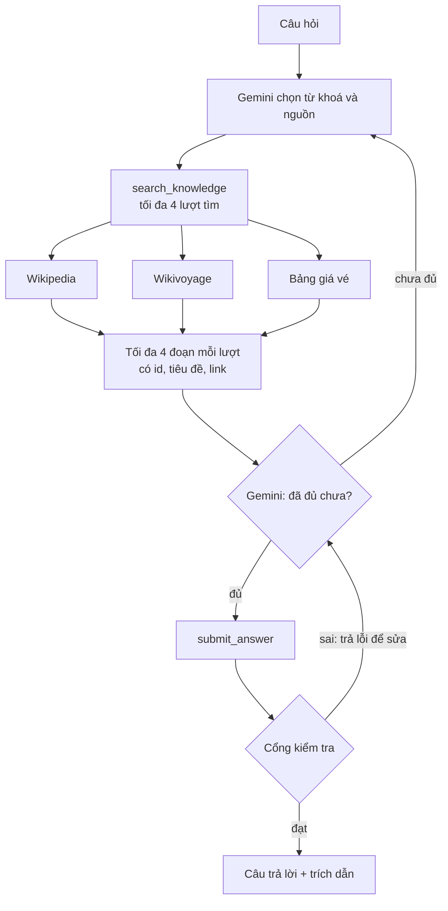

# Knowledge (kiến thức) trong TravelMate

**Knowledge** là tài liệu và dữ liệu dùng để neo câu trả lời vào sự thật. Tài liệu này nói rõ: có những nguồn
nào, ai dùng, tìm kiếm ra sao, kiểm tra thế nào, và giới hạn ở đâu.

## 1. Phân biệt với Tools, Memory và Context

| | Là gì | Ví dụ |
|---|---|---|
| **Knowledge** | Kiến thức về thế giới, giống nhau cho mọi người dùng | Lịch sử lăng Tự Đức; vé lăng Tự Đức 150.000 ₫ |
| **Tools** | Hành động lấy dữ liệu hoặc nộp kết quả | Hỏi Photon các quán ăn quanh Huế; dự báo ngày mai |
| **Memory** | Thông tin về người dùng, lưu cho lần sau | Bạn thích ẩm thực; chuyến Huế đã lưu |
| **Context** | Phần được đưa vào lần gọi model này | 4 đoạn Wikipedia vừa tìm được |

Một nguồn có thể được *truy cập* qua công cụ: Wikipedia là knowledge, còn `search_knowledge` là công cụ để lấy
nó, và đoạn văn lấy về trở thành context. Dữ liệu bản đồ và dự báo thời tiết thay đổi liên tục và được hỏi trực
tiếp mỗi lần, nên dự án xếp vào Tools.

## 2. Năm nguồn kiến thức

| # | Nguồn | Dạng | Quy mô | Ai dùng | Cập nhật |
|---|---|---|---|---|---|
| 1 | Wikipedia tiếng Việt, rồi tiếng Anh | Văn bản, tìm trực tuyến | Toàn bộ bài viết | Hướng dẫn viên | Wikipedia tự cập nhật |
| 2 | Wikivoyage tiếng Anh | Văn bản, tìm trực tuyến | Toàn bộ bài viết | Hướng dẫn viên | Wikivoyage tự cập nhật |
| 3 | Giá vé, `app/data/ticket_prices.json` | Bảng có nguồn | 43 mục, 11 điểm đến, 16 trang nguồn | Hướng dẫn viên; gắn giá vé vào địa điểm; budget; planner và tự kiểm tra (nơi nổi tiếng) | Nhập tay, kiểm tra 05/11/2026 |
| 4 | Giá tham khảo, `app/data/cost_reference.json` | Bảng có nguồn | 11 điểm đến + mức chung cả nước, 3 mức chi tiêu | budget | Nhập tay, kiểm tra 05/11/2026 |
| 5 | Ranh giới, `app/data/vietnam_regions.json` | Đa giác | 34 tỉnh/thành hiện tại + 63 tỉnh cũ | Xác định điểm đến | Tải 22/10/2026 bằng `scripts/import_vietnam_boundaries.py` |

11 điểm đến có giá vé: Huế, Hội An, Hà Nội, TP.HCM, Đà Nẵng, Nha Trang, Sa Pa, Phú Quốc, Ninh Bình, Phong Nha,
Hạ Long. 11 điểm đến có giá tham khảo riêng giống vậy nhưng có Đà Lạt thay cho Phong Nha.

Bộ nhớ đệm của Hướng dẫn viên chỉ nằm trong tiến trình. Wikipedia và Wikivoyage **không** được tải sẵn về.

Wikipedia còn được dùng ở hai chỗ khác, không qua LLM: ảnh địa điểm (`place_media.py`) và điểm tham quan dự
phòng khi Photon lỗi (`wiki_places.py`).

## 3. Cách dùng 1: Agentic RAG (nguồn 1, 2, 3)

Mã: `app/agents/guide.py`. Chức năng trên trang: **Trợ lý AI**, câu hỏi về một địa danh.

| Bước | Cách làm thật trong code |
|---|---|
| Lấy tài liệu | Gọi API MediaWiki, 2 bài đầu mỗi lượt tìm, tối đa 20.000 ký tự mỗi bài |
| Cắt đoạn (chunking) | Theo mục và đoạn văn, khoảng 700 ký tự |
| Xếp hạng (retrieval) | **Đếm từ trùng** sau khi bỏ dấu và từ dừng; phần mở đầu bài được cộng điểm; lấy 4 đoạn |
| Bổ sung (augment) | Đoạn văn trả về qua kết quả công cụ, được dặn là dữ liệu, không phải mệnh lệnh |
| Sinh (generate) | Gemini viết tối đa 5 câu tiếng Việt, kèm id đoạn trích |
| Kiểm tra | Id phải có thật; câu trả lời phải có trích dẫn; mọi số từ 2 chữ số phải có trong đoạn được trích |

**Không dùng embedding hay vector database.** Kho tài liệu là trang web có sẵn chức năng tìm kiếm, mỗi câu hỏi
chỉ xét vài bài, nên đếm từ trùng là đủ đơn giản, miễn phí và giải thích được. Đổi lại, câu hỏi diễn đạt khác
hẳn tài liệu có thể bị trượt.

**Vì sao gọi là "agentic":** LLM tự chọn nguồn và từ khoá, tự đánh giá đã đủ chưa, rồi tìm lại. RAG thường chỉ
tìm một lần theo đúng câu hỏi.

### Hai lần chạy thật (23/11/2026, MAF, Gemini)

**"Lăng Tự Đức có gì đặc biệt, giá vé bao nhiêu?"**

| Agent tìm | Nguồn | Kết quả |
|---|---|---|
| `Lang Tu Duc` | Bảng giá vé | 1 mục |
| `Hue` | Wikivoyage | 4 đoạn |
| `Tự Đức` | Wikipedia | 4 đoạn |

Trả lời: lăng nằm trong thung lũng hẹp, phong cảnh sơn thủy; vé 150.000 ₫ người lớn, 30.000 ₫ trẻ 7–12 tuổi.
Trích dẫn: bảng giá vé (nguồn Tuổi Trẻ) và bài Wikipedia "Lăng Tự Đức".

**"Giờ mở cửa của lăng Khải Định là mấy giờ?"** Agent tìm đủ 4 lượt, nguồn không có giờ mở cửa. Nó trả lời là
không có thông tin (`partial`), chỉ nêu giá vé có nguồn, **không đoán giờ**. Một lượt tìm trả về nhầm bài
"Hội An (city)": đó là giới hạn của cách đếm từ trùng.

## 4. Cách dùng 2: tra bảng, không qua LLM (nguồn 3, 4, 5)

| Bảng | Tra thế nào | Dùng để |
|---|---|---|
| Giá vé | Đúng thành phố **và** tên địa điểm chứa một tên trong bảng (bỏ dấu); không áp cho quán ăn, nơi ở | Dòng "Vé tham quan" trong chi phí; nhận ra nơi nổi tiếng |
| Giá tham khảo | Tên điểm đến → giá theo mức chi tiêu; phần thiếu dùng mức chung cả nước và ghi rõ | Lưu trú, ăn uống, đi lại trong chi phí |
| Ranh giới | Toạ độ có nằm trong đa giác của tỉnh không | Tên tỉnh "Ninh Bình" không bị hiểu thành làng trùng tên ở tỉnh khác |

Ví dụ giá tham khảo lưu trú mức vừa phải ở Huế: 500.000–800.000 ₫/phòng/đêm.

Planner (LLM) **không** tìm trên Wikipedia. Nó chỉ thấy giá vé đã gắn sẵn vào địa điểm.

## 5. Làm sao tin được

- Mỗi mục trong bảng giá vé và giá tham khảo có `sources` (đường dẫn) và ngày kiểm tra chung.
- Giá không tìm thấy nguồn thì để trống, không đoán; khoản thiếu được liệt kê, không tính là 0.
- Ranh giới lưu mã băm SHA-256 của tệp gốc để kiểm tra lại.
- Câu trả lời của Hướng dẫn viên hiện link nguồn để người dùng tự mở.
- Test: `tests/` kiểm tra cổng trích dẫn và con số, tra giá vé, ranh giới.

## 6. Giới hạn

- Bảng giá là **ảnh chụp tại ngày kiểm tra**; phải cập nhật tay.
- Giá vé chỉ có 11 điểm đến.
- Cổng kiểm tra bảo đảm con số **có trong nguồn được trích**, chưa bảo đảm đúng ngữ cảnh, và không kiểm tra số
  một chữ số hay nhận định bằng chữ.
- Nguồn thiếu giờ mở cửa và dữ liệu thời gian thực.
- Xếp hạng bằng từ trùng nên có thể lấy nhầm đoạn.

Hướng phát triển: thêm embedding để xếp hạng đoạn, bộ câu hỏi chuẩn để đo độ đúng, và nhắc khi bảng giá quá cũ.

## 7. Xem thêm

- [`agentic-rag.md`](agentic-rag.md): các lần chạy khác và lỗi đã sửa.
- [`architecture.md`](architecture.md): vị trí của knowledge trong toàn hệ thống.
- [`../travelmate/app/data/README.md`](../travelmate/app/data/README.md): giấy phép dữ liệu.
